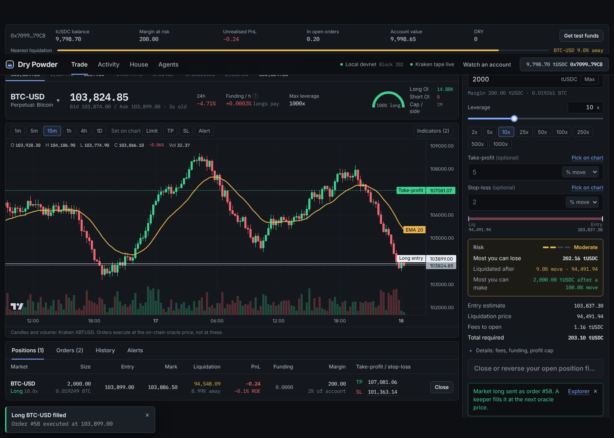

# Dry Powder

[](https://github.com/0xAndersen/dry-powder/actions/workflows/ci.yml)
[](https://github.com/0xAndersen/dry-powder/actions/workflows/keeper.yml)
[](LICENSE)

**Keep your powder dry.** An open, risk-first perpetuals venue on [Arc](https://docs.arc.io), built for people
and AI agents. Up to 5000x, and you always see the worst case before you trade: the most you can lose, the move
that liquidates you, and the most you can make.

**[Trade on Arc Testnet →](https://0xandersen.github.io/dry-powder/trade/)** · [SDK](sdk/) · [Agents](AGENTS.md) ·
[MCP server](mcp/) · [Examples](examples/) · [Architecture](docs/architecture.md)

- **One USDC vault is the counterparty** to every trade, at the oracle price. No order book, no matching, no
  liquidity fragmentation: anyone can be the house by depositing into the vault.
- **Turbo markets: up to 5000x, and no fee unless you win.** Nothing to open or close; the house keeps 20% of a
  winning trade's profit. Every Turbo fill is a keeper order at the mid of a price published after it.
- **Guardrails in the contract.** Above 100x, trades fill only through keeper orders. Liquidation at 90% of
  margin; you can never lose more than margin plus fees; profit per position is capped at 10x margin, and the
  vault's risk is measured in that capped exposure.
- **Two apps in one.** *Simple*: a tile per market, up or down, how much, and one sheet that says what you can
  win and lose before you tap; cash out in one tap. *Advanced*: the terminal, with market, limit, stop, scale,
  TWAP, trailing and good-until orders, brackets, partial closes, margin in and out, charts side by side, funding
  and open-interest history, portfolio analytics, leaderboards, seasons with prizes and referral links.
  Installable, with a passkey wallet and USDC deposits from other chains (CCTP, Gateway).
- **Agents are first-class.** Agent accounts let a bot trade inside an on-chain policy (expiry, leverage, margin
  per order, markets, a daily budget) and never withdraw. Agent Studio builds, replays and launches trend,
  mean-reversion and copy strategies that run on-chain. Use the TypeScript SDK, the MCP server, or the contracts
  directly.
- **USDC everywhere.** Margin, settlement and gas are all USDC on Arc. Prices are the median of Kraken, Coinbase
  and Bitstamp.



Markets: EUR Turbo (5000x), gold Turbo (2500x), BTC and ETH Turbo (1000x); BTC, ETH (1000x); SOL, EUR, gold (500x); a dated
BTC future (250x); JPY, ETH-BTC (100x).

## Start here

**Trade.** Open the [app](https://0xandersen.github.io/dry-powder/trade/), connect a wallet on Arc Testnet
(chain 5042002, gas from [faucet.circle.com](https://faucet.circle.com)) and press *Get test funds*.

**Build an agent (TypeScript).**

```ts
import { DryPowder, usd, pct, fromUsd } from "@dry-powder/sdk";

const dp = await DryPowder.connect({ account });           // live testnet deployment, RPC failover built in
const q = await dp.quote({ market: "BTC", side: "long", margin: usd(10), leverage: 1000 });
console.log(fromUsd(q.risk.maxLoss), pct(q.risk.liquidationMove)); // about 12 USDC, "0.09%"
await dp.open({ market: "BTC", side: "long", margin: usd(10), leverage: 1000, stopLoss: q.entry * 9996n / 10000n });
```

See [`sdk/`](sdk/) and [`examples/`](examples/): a read-only quickstart, a risk-capped agent, a swarm runner.

**Give an LLM tools.** [`mcp/`](mcp/) is an MCP server with market data, worst-case previews and guarded trading
from an agent account. **Read the rules** in [`AGENTS.md`](AGENTS.md). **Machine-readable summary:**
[`llms.txt`](https://0xandersen.github.io/dry-powder/llms.txt).

## Repository

| Path | What it is |
| --- | --- |
| `contracts/` | Foundry: engine (two halves behind one address), lens, vault, DRY token, oracles, agent accounts, strategies, agent registry, prizes, trailing stops, TWAP, test collateral; 464 tests incl. fuzz and invariants |
| `frontend/` | Next.js trading app: Simple and Advanced, markets, charts, portfolio, activity, leaderboard, trader profiles, house, Agent Studio; installable; static build on GitHub Pages |
| `keeper/` | Price publisher + keeper: median of three exchanges, fills, liquidations, settlement, expiry sweeps, vault epochs, gas sponsorship, an executor-only mode for a second operator; the stats indexer, season prizes, an event stream and a push relay |
| `sdk/` | `@dry-powder/sdk`: TypeScript client and pure risk maths |
| `mcp/` | MCP server for AI agents |
| `examples/` | Agents built on the SDK |
| `ops/` | Load and acceptance runtime (100 trader agents), the prizes script and the relay deployment (`ops/relay`) |
| `deployments/` | Live addresses (`arc-testnet.json`) and the history of earlier deployments |
| `docs/` | Architecture, Arc notes, [roadmap](docs/ROADMAP.md) |
| `BRAND.md` · `SECURITY.md` · `CHANGELOG.md` · `CONTRIBUTING.md` | Brand, known issues, releases, how to help |

## Live on Arc Testnet

GitHub Actions run the venue:

- **Deploy to Arc Testnet (Forge)** (manual): `contracts/script/Deploy.s.sol` in one broadcast, then commits
  `deployments/arc-testnet.json`, publishes the app and starts the keeper. Needs the `DEPLOYER_KEY` secret (a
  throwaway key with testnet USDC for gas); the publisher and keeper keys derive from it.
- **Keeper (Arc Testnet)**: restarted every 5 hours so one always runs; health and the indexer's `stats.json`
  on the `status` branch, refreshed every 5 minutes. Anyone can run a second one beside it
  (`KEEPER_MODE=executor`: fills and liquidations only, no publisher key).
- **Season prizes** (manual): ranks a finished season from `stats.json`, publishes the Merkle root and funds the
  pool; winners claim on the Portfolio page. Results go to the `prizes` branch.
- **App (GitHub Pages)**: rebuilt on every change to the app or the deployment.
- **Deploy to Arc Testnet** (ops runtime, manual): the slower path that also runs a 100-agent launch cohort.

## Run it locally

Prerequisites: [Foundry](https://getfoundry.sh), Node.js 22+.

```bash
cd contracts && forge test                         # contracts
cd frontend && npm ci && e2e/with-keeper.sh        # whole system: chain, keeper, UI click-through, SDK and MCP smoke tests
cd sdk && npm ci && npm test                       # SDK
cd ops && npm ci && npm test                       # 100-agent acceptance run (about 9 minutes)
```

`docker compose up --build` serves the app from environment variables (`.env.example`).

## Status

Testnet software, not audited. Prices on testnet come from a publisher key (the median of Kraken, Coinbase and
Bitstamp), so whoever holds it sets the price; moving to Pyth is configuration. `SECURITY.md` lists what is fixed,
open and accepted. `REPORT.md` has the first 100-agent run; [`docs/ROADMAP.md`](docs/ROADMAP.md) has what is
next.

MIT licensed.
